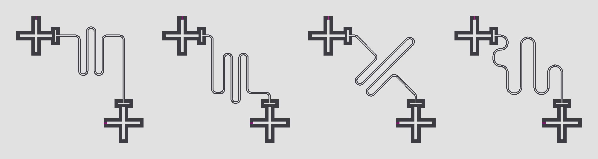
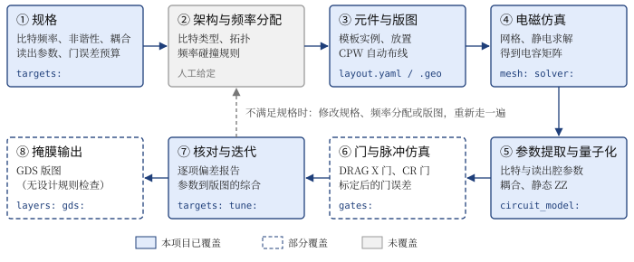
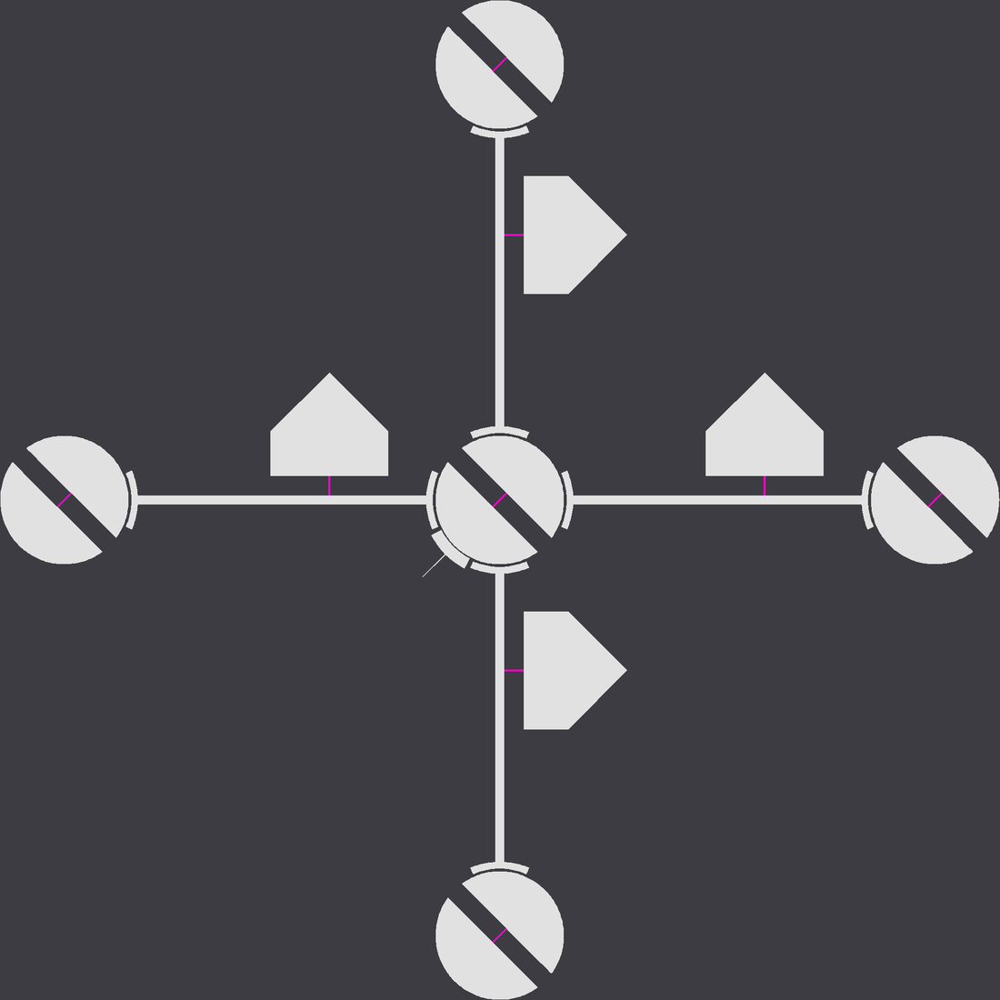
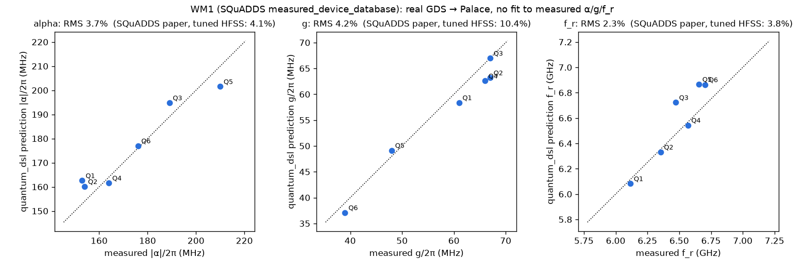
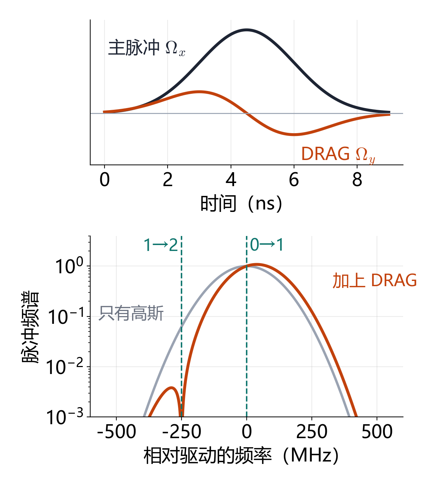
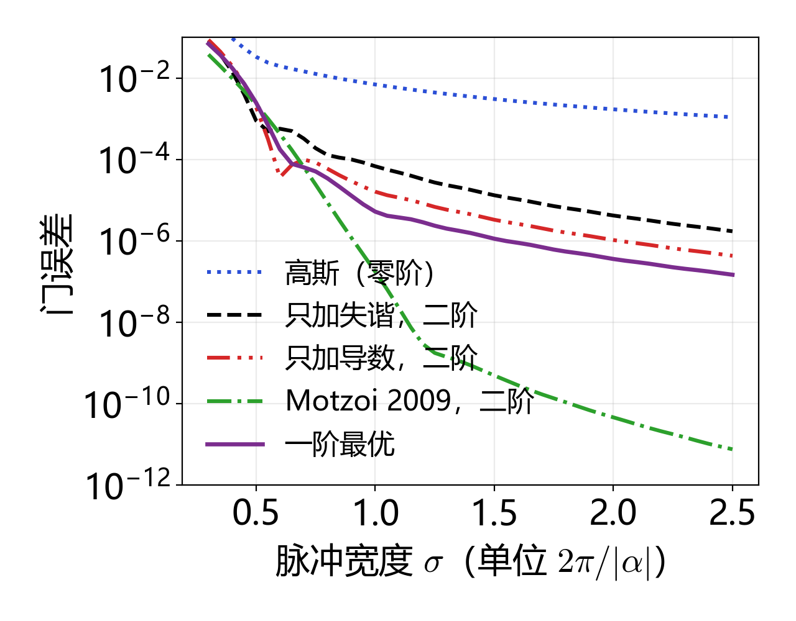
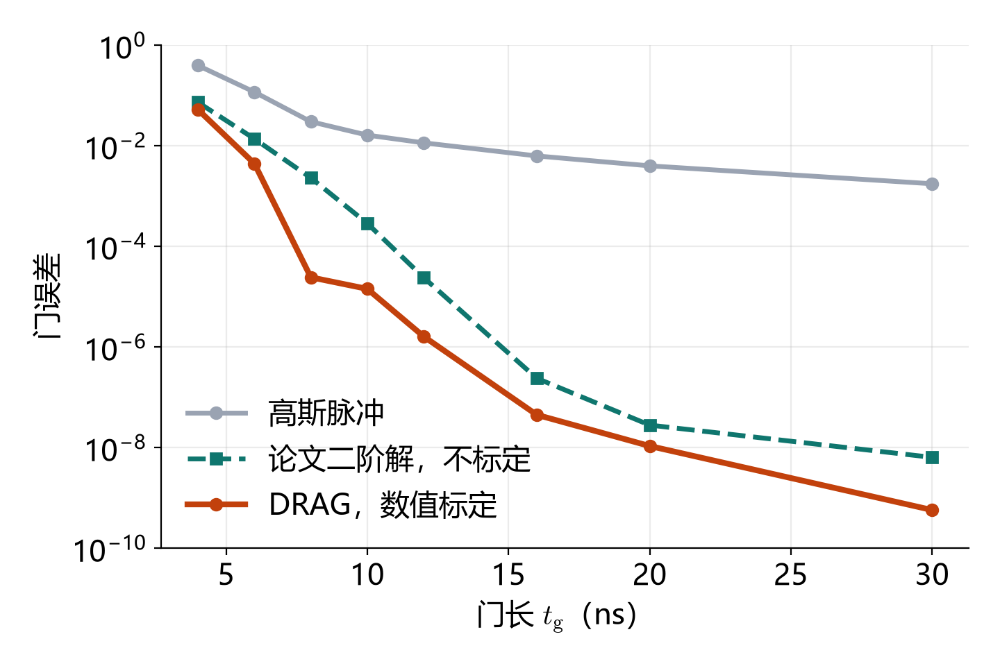
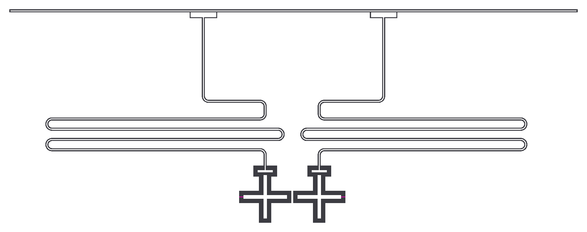
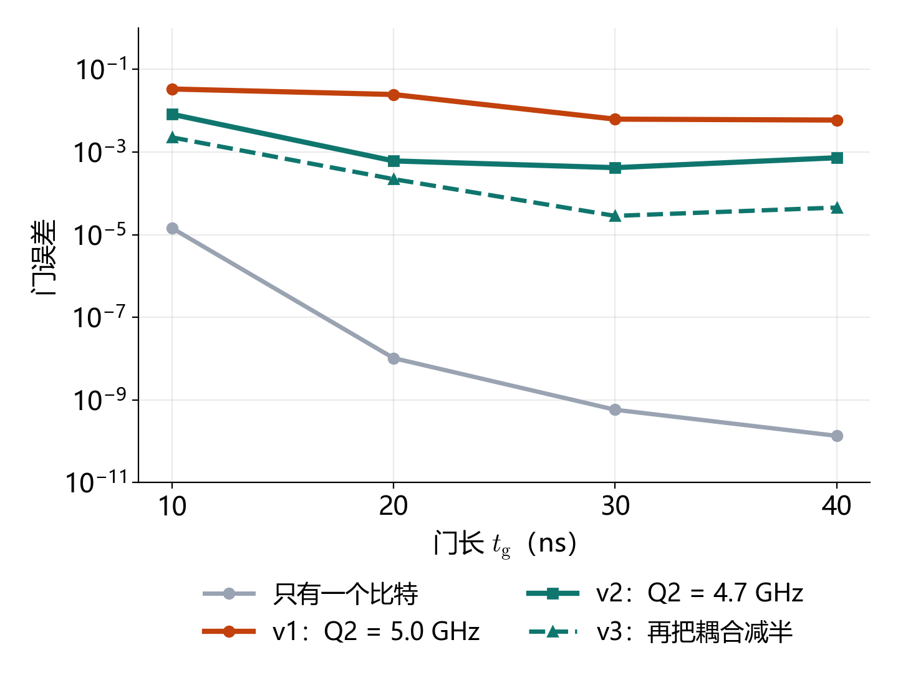

# 超导量子处理器设计自动化

<div class="sub">SRT 项目结题报告</div>

<table class="front">
<tr><td>项目名称</td><td>超导量子处理器设计自动化</td></tr>
<tr><td>指导教师</td><td>陈建鑫（计算机科学与技术系）</td></tr>
<tr><td>项目成员</td><td><span class="todo">（待填：五位成员的姓名、院系与分工）</span></td></tr>
<tr><td>执行时间</td><td>2025 年 9 月 — 2026 年 9 月</td></tr>
<tr><td>报告日期</td><td>2026 年 11 月</td></tr>
</table>

<div class="abstract">

**摘要**　超导量子芯片的设计需要在版图软件、电磁仿真软件和电路分析程序之间反复传递数据，几何、电学连接、仿真设置和设计指标分散在不同的工具里，难以复现，也难以自动化。本项目借鉴经典芯片设计中硬件描述语言的思路，设计了一种面向超导量子芯片的描述语言 quantum_dsl，并实现了配套的工具链。一份描述文件同时记录几何、电学节点、求解设置和设计目标；一次构建即可得到流片用的 GDS 版图、电磁仿真网格、电容矩阵、哈密顿量参数和门误差，并与设计目标逐项核对；给定目标参数时，工具链还能反过来调整版图。

工具链建立在开源软件 Gmsh、Palace 和 SuperGrad 之上，核心代码约 5 500 行，自动测试 103 条。我们用已发表的器件检验了各个阶段：在 Chen 等 2025 年的倒装芯片上，用实测非谐性这一个量标定芯片间距后，比特与耦合器之间耦合强度的预测与设计值相符；在一块公开了版图和实测数据的芯片上，不按实测结果调整几何与材料，预测的非谐性、耦合强度和读出腔频率与实测的均方根偏差约为 4%、4% 和 2%（结参数由实测比特频率反推，不是严格的盲测）；按论文照片描出的 Sung 等 2021 年器件版图则没有对上；门仿真部分逐图复现了 Gambetta 等 2011 年关于 DRAG 脉冲的论文。最后，我们用一个两比特芯片演示了「规格 → 版图 → 电磁仿真 → 哈密顿量 → 门仿真 → 修改规格重新综合」的完整过程。

项目完成了申请书中物理层的内容，并向上延伸到哈密顿量和门级仿真；线路层与网表层的描述语言没有开展，留作后续工作。

</div>

## 1　量子硬件描述语言

### 1.1　背景与问题

超导量子芯片是衬底上的平面金属图形加上约瑟夫森结。设计者真正关心的是哈密顿量参数：比特频率 $f_{01}$、非谐性 $\alpha$、比特之间的耦合强度 $g$、读出腔的色散位移 $\chi$ 和线宽 $\kappa$。这些量由金属图形的几何决定，从几何算到参数，要依次经过版图绘制、电磁仿真和电路分析三类软件。

项目第一阶段，我们分两组试用了现有的两种开源工具，目标都是画出 2×2 的比特阵列。使用 Qiskit Metal 的一组完成了带读出腔和控制线的四比特版图，并总结出三个问题：

- 设计写成 Python 脚本，大量变量名只用来在脚本内部传递坐标，冗余，也难以检查；
- 描述里只有几何，没有可以用来建立哈密顿量的信息：哪块金属是哪个电学节点、结接在哪两块金属之间、参数多大，都要在别处另写一遍；
- 已有的 GDS 版图无法带着这些物理信息导入。

另一组从在 KLayout 中手工绘制开始，随后改用 KQCircuits 的参数化元件。两组得到同一个结论：两种工具描述的都只是几何。几何之外的信息——材料、网格和求解设置、期望得到的参数值——散落在各个工具的脚本和界面里，每换一个工具就要手工重新输入一次。

经典数字电路设计用硬件描述语言（Verilog 等）解决了类似的问题：设计是一份文本，综合、仿真和检查工具都读同一份文本。我们在第一阶段学习了 Verilog 和 Verilog-A，并据此确定了项目的目标：为超导量子芯片设计一种文本描述，让它同时承载几何和物理信息，后续的每个工具都从这一份描述出发。

### 1.2　两层输入，一个绑定键

quantum_dsl 把一颗芯片的描述分成两层文件（表 1）。几何层只画金属图形；物理层写其余的一切，不含任何坐标。

<p class="cap">表 1　描述文件的两层</p>

| 层 | 文件 | 写什么 |
|---|---|---|
| 几何 | `<名字>.geo`（Gmsh 脚本，长度单位统一为 µm），或 `<名字>.layout.yaml`（用模板编排版图，见 1.3 节） | 金属图形、每块金属所属的电学岛、结的位置 |
| 物理 | `<名字>.meta.yaml` | 材料、计算域、网格、求解器、GDS 图层；结参数、谐振腔与端口（`circuit_model`）；设计目标（`targets`）、综合旋钮（`tune`）、要仿真的门（`gates`） |

两层之间靠一个约定连接。几何文件里每块金属面都有一个四段的名字 `role::layer::component::primitive`，其中 `component` 段是这块金属所属的**电学岛**：同名的面是同一个导体。电容矩阵的行和列、结的两端、谐振腔和端口，全都用这个名字引用。于是从版图到哈密顿量的整条链路上，同一个导体始终是同一个名字，不需要在工具之间手工对应编号。

下面是仓库中最小的例子：两块 80 µm 见方的金属焊盘。几何文件只有七行：

```geo
SetFactory("OpenCASCADE");
padA = news;
Rectangle(padA) = { -120, -40, 0, 80, 80 };
Physical Surface("metal::1::A::pad") = { padA };
padB = news;
Rectangle(padB) = { 40, -40, 0, 80, 80 };
Physical Surface("metal::1::B::pad") = { padB };
```

物理文件给出其余信息（排版略有压缩）：

```yaml
schema: quantum-dsl/meta/1
geo: two_pads.geo
materials: {substrate: {eps_r: 11.45, thickness_um: 100}}
airbox:    {top_um: 120, bottom_um: 120, side_um: 80}
mesh:      {max_size_um: 40, min_size_um: 4}
solver:    {type: electrostatic, order: 2}
gds:       {by_role: {metal: {layer: 1, datatype: 0}}}
circuit_model:
  qubits:
    - {name: A, island: A, L_J: 10nH}
    - {name: B, island: B, L_J: 10nH}
```

调用 `quantum_dsl.build("two_pads.meta.yaml", "out/", solve=True)`，就得到 GDS 文件、三维网格、Palace 的配置文件、2×2 的电容矩阵，以及两个比特各自的 $E_C$、$f_{01}$、$\alpha$ 和它们之间的 $g$，全部写在一份 `results.yaml` 里。

### 1.3　模板、端口与路由

实际的芯片由重复的元件组成。版图文件 `*.layout.yaml` 是一张有序的步骤表，每一步是下面三种之一：

- **放置**：在给定的位置、转角实例化一个模板，例如一个比特；
- **连接**：在两个端口之间实例化一个模板，例如耦合器或一段共面波导（CPW）。连接的长度可以直接按目标谐振频率给定；
- **手写**：混入一段手写的 `.geo`，用于模板库里没有的图形。

模板由两个文件组成：一份在局部坐标下画图的 `.geo`，和一份声明接口的 yaml（参数及默认值、端口、所在的层、结的位置）。端口是一段端面的中点、外法向和线宽。**路由同时是电连接**：路由体和它两端的金属合并成同一个电学岛；如果路由没有真正碰到端口，或者碰到了别的岛（短路），工具链会报错。编排器还会顺带生成物理层的一部分内容：模板里的结自动登记为比特，按频率定长的路由自动登记为谐振腔。

仓库现有八个模板：矩形焊盘、Xmon、圆盘形 transmon、条形耦合器、读出爪、馈线耦合焊盘，以及两种 CPW 连线。其中 `cpw_route` 带自动布线：给出两个端口、允许走线的区域和目标长度，规划器自行决定路径和蛇形的排布（图 1，细节见 4.1 节）。

<figure>

<figcaption>图 1　自动布线示例。四对 Xmon 之间各连一条长度相同（3 000 µm）的 CPW，从左到右依次是：横平竖直、在拼接而成的区域内绕行、自由角度、自动选取最大弯曲半径。</figcaption>
</figure>

### 1.4　求解之前先查错

描述文件是数据而不是程序，所以很多错误可以在生成网格之前查出来。工具链的原则是「拒绝静默」：物理文件里出现不认识的键、有导体没有被任何结或谐振腔引用、不同电学岛的金属相碰、数值是 NaN，都直接报错，而不是套一个默认值继续算。

这条原则来自早期版本的两次教训。一次是把一块没有声明用途的导体默认接地，结果一条 25 MHz 的间接耦合被算成了零；另一次是把浮动 transmon 的两块焊盘当成了同一个导体，总电容错了 1.7 倍。两次都没有任何报错，后一次连测试也全部通过。

### 1.5　项目历程

<p class="cap">表 2　项目各阶段的工作</p>

| 时间 | 工作 |
|---|---|
| 2025.10 — 12 | 基础理论与技能学习（申请书第一阶段） |
| 2026.03 | 仿照 scqubits 编写电路量子化程序；学习 Verilog 与 Verilog-A |
| 2026.04 — 05 | 分两组试用 Qiskit Metal 与 KQCircuits，绘制 2×2 比特阵列，总结现有工具的问题；调研串扰标定的贝叶斯优化方法 |
| 2026.04 — 07 | 第一版语言：YAML 描述经中间表示转换为 Qiskit Metal 设计；接入 Gmsh 与 Palace，实现由一份描述得到电容矩阵和哈密顿量 |
| 2026.07 — 08 | 以 Sung 等 2021 年的可调耦合器器件 [7] 为对照，检验电容提取；重写为第二版，即现行版本 |
| 2026.09 | 模板库与版图编排；Chen 等 2025 年的 3×3 比特阵列 [8]；CPW 自动布线 |
| 2026.10 | 读出链路进入电路模型；参数到版图的综合；门仿真 |

第一版建立在 Qiskit Metal 之上。重写的原因有三个：它依赖 Qiskit Metal，而该软件在新版 Python 下已无法安装；它把金属表示成有厚度的薄板再从真空里挖掉，这一做法在几何运算上很脆弱，为了绕开失败而引入的修补本身又成了误差来源（见 4.1 节）；它有多条不报错的出错路径。现行版本直接以 Gmsh 的几何脚本为底层，金属用零厚度的面表示，每一项功能都对应一条写明的契约和相应的测试。

## 2　超导量子芯片的设计自动化流程

### 2.1　流程的各个阶段

量子芯片设计自动化（quantum design automation，QDA）指的是把超导量子芯片从指标到掩膜的设计过程交给软件完成。参照现有工具和文献的做法，我们把这个过程分成八个阶段（图 2）。

<figure>

<figcaption>图 2　超导量子芯片的设计流程，以及 quantum_dsl 覆盖的范围。每个方框最后一行是描述文件中对应的字段。</figcaption>
</figure>

1. **规格**：比特数目与连接方式，各比特的频率和非谐性，耦合强度，读出腔的频率、色散位移与线宽，门的方案和误差预算。
2. **架构与频率分配**：选定比特类型（固定频率或可调）和耦合方式，给每个比特分配频率，避开频率碰撞。
3. **元件与版图**：设计比特、耦合器、读出腔的几何，在芯片上放置并布线。
4. **电磁仿真**：对版图做静电仿真得到电容矩阵，或做本征模、频域仿真得到模式频率与损耗。
5. **参数提取与量子化**：由电容、电感和结参数建立哈密顿量，得到第 1 步规格中的各个量。
6. **门与脉冲仿真**：在哈密顿量上做含时演化，设计并标定控制脉冲，得到门误差。
7. **核对与迭代**：把第 5、6 步的结果与规格比较，不满足时回到前面的阶段修改。
8. **掩膜输出**：生成 GDS 文件，送去流片。

### 2.2　现有工具各自覆盖哪一段

表 3 列出了有代表性的开源工具。内容根据公开资料整理；其中 KQCircuits、QPDK、EDA-Q、DeviceLayout.jl、SQDMetal 和 SQuADDS 六种，我们在 2026 年 10 月实际部署并运行过同一个例子。

<p class="cap">表 3　现有开源工具及其覆盖的阶段</p>

| 工具（开发方） | 设计的描述方式 | 覆盖的阶段 |
|---|---|---|
| Qiskit Metal（IBM）[17] | Python 接口与图形界面 | 版图；导出到电磁仿真软件；集总模型与能量参与比分析 |
| KQCircuits（IQM）[18] | KLayout 的参数化单元 | 版图（包括倒装芯片的两面）；导出到 Elmer、Ansys 等求解器；开源路线给出电容矩阵，哈密顿量参数要经商用软件的本征模仿真得到 |
| gdsfactory + QPDK [23] | Python 与 YAML（实例、放置、连接、布线） | 版图；经插件导出到 Palace 等求解器提取电容 |
| DeviceLayout.jl（AWS）[22] | Julia | 版图；生成 Palace 的网格，求解配置部分手写 |
| SQDMetal（昆士兰大学）[20] | Qiskit Metal 的设计 | 用 Palace 做静电与本征模仿真，提取电路参数 |
| EDA-Q（国内）[19] | Python 接口 | 拓扑到版图、自动布线、铟柱与空气桥；仿真依赖商用软件 |
| PalaceForCQED（清华）[21] | 由 GDS 转换的几何 | 基于 Palace 的电磁特征提取 |
| SQuADDS（南加州大学）[16] | 预先仿真好的设计数据库 | 由目标参数检索并插值出几何，不运行仿真 |
| QDesignOptimizer（查尔姆斯理工）[15] | Qiskit Metal 的设计 | 仿真在环的多参数几何优化 |
| scqubits、SQcircuit | Python | 电路量子化与能谱 |
| SuperGrad [13]、QuTiP 等 | Python | 含时演化与脉冲优化 |

此外还有商用和在线的工具，如 Ansys HFSS / Q3D、Keysight QuantumPro、本源坤元、量旋天乙。

从表中可以看到，每种工具覆盖流程中的一段，段与段之间靠使用者手工或自写脚本传递数据。以我们实测过的工具为例：版图类工具的描述里没有电学节点和结，电容矩阵之后的分析要另行完成；仿真类工具从别处接收几何，端口和导体往往要按坐标或编号重新指定；门仿真工具则完全独立，输入是手填的哈密顿量参数。本项目要做的，是让一份描述贯穿这些阶段。

## 3　描述语言在流程中的覆盖范围

### 3.1　覆盖情况

表 4 按第 2 节的阶段列出：描述文件里写什么，工具链做什么，得到什么。

<p class="cap">表 4　quantum_dsl 对设计流程的覆盖</p>

| 阶段 | 描述文件里写什么 | 工具链做什么 | 产物 | 状态 |
|---|---|---|---|---|
| ① 规格 | `targets`：期望的 $C_\Sigma$、$E_C$、$f_{01}$、$\alpha$、$g$、$f_r$、$\chi$、$\kappa$、ZZ 及各自的容差 | 加载时检查名字，求解后逐项比较 | `validation` 段 | 已覆盖 |
| ② 频率分配 | — | — | — | 未覆盖，由人给出规格 |
| ③ 版图 | `.geo` 或 `layout.yaml`：模板实例、手写几何、端口之间的路由、地平面 | 编排成一个几何模型；自动布线；检查短路与归属 | 几何模型，结与谐振腔的清单 | 已覆盖（倒装芯片只支持把另一片当作整块地） |
| ④ 电磁仿真 | `materials` `airbox` `mesh` `solver` | 生成网格与 Palace 配置，运行静电求解 | 网格，电容矩阵 | 已覆盖静电；本征模只有对照用的工具 |
| ⑤ 量子化 | `circuit_model`：结、谐振腔、端口 | 逆电容集总模型、精确能级、读出链路、静态 ZZ | `hamiltonian` 段 | 已覆盖 transmon 类比特 |
| ⑥ 门仿真 | `gates`：门的种类、比特、门长、误差预算 | 在 SuperGrad 上标定 DRAG X 门和 CR 门 | `gates` 段 | 部分覆盖（无退相干） |
| ⑦ 核对迭代 | `tune`：哪个几何参数对准哪个目标 | 电磁仿真在环迭代，直到全部目标命中 | 调整后的描述文件 | 已覆盖器件级参数 |
| ⑧ 掩膜输出 | `layers` 或 `gds`：层到 GDS 图层的映射 | 面转成多边形，写 GDS | GDS 与预览图 | 已覆盖（无设计规则检查） |

表中所有产物都由同一次 `build` 调用得到，写进同一个输出目录；`manifest.yaml` 记录每个输入和输出文件的哈希值，结果可以追溯到产生它的那份描述。

### 3.2　与同类描述方式的差异

就我们所知，同类工具中用配置文件描述整片设计的只有 gdsfactory / QPDK，它的配置包含实例、放置、连接和布线。我们的描述多出四类信息：电学节点、材料与求解设置、结参数、设计目标与容差。我们把同一个器件（一个 Xmon 加一条半波长读出腔，接到一条馈线上）分别用两种方式写了一遍：quantum_dsl 用 21 行 YAML，一次构建得到电容矩阵和 $E_C$、$f_{01}$、$\alpha$、$g$、$\chi$、$\kappa$；QPDK 的 YAML 写法用 41 行，这份文件本身只能得到 GDS，电容提取要另写程序调用插件，读出腔的长度也需要另写程序迭代求出。

「用代码描述比手工绘图好」对所有同类工具都成立，不是我们的特点。配置文件相对于程序接口多出来的好处有三条：

- 求解之前就能做静态检查（1.4 节）；
- 配置是数据，可以由程序生成和比较。4.4 节的综合功能，输出就是一份普通的描述文件；
- 设计和验收标准写在同一处，结果是否达标由工具链判断。

代价也很明确：YAML 没有循环和表达式，复杂的图形仍要退回到 `.geo` 脚本里写；没有图形界面。

### 3.3　没有覆盖的部分

- **申请书中的线路层和网表层**：量子线路的综合与映射、网表级的描述语言都没有开展。物理文件里的 `circuit_model` 只起到集总电路网表的作用。
- **架构与频率分配**：比特频率、耦合强度的取值目前由人给定。第 5 节的例子表明，这一步的选择对门误差的影响远大于脉冲设计。
- **版图的其他内容**：倒装芯片另一片上的走线、铟柱、空气桥、控制线画不了；没有设计规则检查；不能把已有的 GDS 导入成可编辑的设计。
- **电磁仿真的其他类型**：本征模和频域仿真没有进入主流程，所以经电感耦合的结构、介质损耗和品质因数算不了。
- **门仿真的真实性**：没有退相干，两比特门没有做回波序列。

## 4　各阶段的实现

工具链是一个 Python 包，共 18 个模块、约 5 500 行，只提供程序接口，没有命令行或图形界面。依赖的外部软件全部开源：Gmsh [24] 负责几何与网格，gdstk 负责写 GDS，Palace [25] 负责电磁求解，SuperGrad [13] 负责含时演化。每项功能在仓库的 `SPEC.md` 中有一条契约，对应 `tests/` 下的测试，目前 98 条通过，另有 5 条需要运行真实求解器的测试默认跳过。

### 4.1　版图与电磁仿真

#### 版图的生成与自动布线

版图编排器按顺序执行版图文件中的步骤，把模板实例、手写几何和路由写进同一个 Gmsh 模型，同时记录每块面属于哪个电学岛。编排结束时做三项检查：每块面都要有归属；不同电学岛的面不能相交或相切；模板画出的外挂金属（例如读出耦合爪）必须有路由连上。

CPW 的自动布线分三步。第一步在两个端口之间找一条骨架，默认只走横平竖直的方向，优先尝试直线、L 形、Z 形等不超过三折的走法；都不可行时，把允许区域划分成轨道图，用最短路算法找转弯最少的路径，这样可以走出任意折数。第二步是定长：目标长度可以直接给出，也可以给谐振频率，由 CPW 的解析公式（含超导薄膜的动态电感）换算成长度；骨架不够长时，在直段上加蛇形，每个弯能伸出多远按它到区域边界、到线路自身的实际距离逐个计算。第三步检查成品：全程不出区域，线路各部分之间保持两倍弯曲半径以上的净距，画出的长度与目标一致，任何一项不满足就报错并说明原因。弯曲半径可以指定，也可以让规划器取能放得下的最大值。

#### 从版图到网格：零厚度的金属面

超导金属内部没有电场，在静电问题里它只是一个等势的边界。我们因此把金属表示成衬底与真空界面上的**零厚度面**，在这个面上给定电位，而不是一块有体积的材料。衬底和真空盒由工具链根据物理文件中的厚度和尺寸生成，金属面一次性嵌入界面，再沿所有导体的边缘加密网格（边缘处电场奇异，电容的误差集中在那里）。

早期版本采用另一种做法：把金属拉伸成 2 µm 厚的板，再从真空中挖掉。这要求金属板与衬底表面精确共面地做几何减法，而几何内核在这种情形下经常失败或悄悄产生错误的拓扑。当时的补救办法是在衬底和金属之间留一条很薄的真空缝，这条缝本身成了误差来源：缝宽 1 µm 时电容偏低 29%，耦合偏低 40%，后来把缝缩到 0.01 µm 才得以缓解。零厚度的做法没有减法运算，这一类问题不再出现。它也更接近实际：真实薄膜只有 100 — 200 nm 厚，而在两焊盘的例子上，2 µm 的人工板厚会使电容矩阵的元素比零厚度时高 0.8% — 1.6%。Palace 的官方例子、KQCircuits 和 SQDMetal 也都采用零厚度的理想导体面。

#### Palace 静电求解

Palace 是亚马逊开源的并行有限元电磁求解器。工具链为它生成网格和配置文件：每个电学岛是一个端子，求解器轮流把一个端子置于 1 V、其余置于 0 V，由各导体上的感应电荷得到电容矩阵的一列，$N$ 个导体求解 $N$ 次。整个工具链内部的长度单位都是 µm，只在 Palace 的配置里声明一次「网格单位为 $10^{-6}$ 米」，避免对几何本身做缩放。

有限元的基函数用二阶。这一项不能省：在两焊盘例子的同一张网格上换成一阶，自电容偏高约 4%，互电容偏高约 7%。

规模较小的例子在工作站上运行，两块焊盘的例子约两分钟。Chen 等的十字结构（19 个导体）约 360 万个四面体，在 64 核、128 GB 内存的云主机上用 28 个进程约 25 分钟，内存峰值约 42 GB。经验上每一百万个未知量需要 8 — 9 GB 内存，求解器一侧可调的余地很小，控制规模主要靠网格尺寸。

大芯片也可以分块求解再拼接：每块单独提取电容矩阵，同名的导体把电容相加，中间导体用舒尔补消去。这种做法会丢掉不同块之间导体的直接电容，所以工具链默认整片求解；采用分块时，有意耦合的两个导体必须放在同一块里，位置靠近却从不在同一块中出现的导体会触发警告。

#### 精度与验证

<p class="cap">表 5　电容提取的验证</p>

| 检验内容 | 做法 | 结果 |
|---|---|---|
| 回归基准 | 两焊盘例子按固定的网格配方重算 | 电容矩阵逐位复现；测试容差 2% |
| 离散误差 | 均匀加密后外推，并与自适应加密比较 | 基准配方比外推值高约 1.6%；网格再细一倍时约 0.8% |
| 求解器之间 | 同一张网格、同为一阶，Palace 对 Elmer | 电容矩阵相对差 $1.9\times10^{-7}$ |
| 工具链之间 | 同一个比特、同样的求解器与计算域、相同的最小网格尺寸，对 SQDMetal | 岛的电容相差 0.3%（111.56 对 111.24 fF） |
| 倒装芯片的近似 | 把另一片当作一整块地，对比 KQCircuits 和 DeviceLayout.jl 中把两片都画出来的模型 | 比特电容相差不超过 0.8% |
| Sung 等 2021 [7] | 按论文照片描出的版图，不调参数 | 两个比特的总电容是论文值的 0.87 倍，耦合器是 0.70 倍，**没有对上** |
| Chen 等 2025 [8] | 倒装芯片，芯片间距 $d$ 未知，用实测 $\alpha$ 标定 | $d=9.9\pm0.7$ µm；此时比特与耦合器的耦合为 85 — 97 MHz，设计值 90 MHz |

对这张表有三点说明。

第一，目前精度的主要限制是**网格收敛**。电容的离散误差总是偏大，并随加密缓慢下降。我们和 KQCircuits 在几何与边界条件都对齐的情况下算同一个比特，我们的总电容高 2.8%，差别全部是离散误差：对方使用三阶单元，并把整条刻蚀缝铺满细网格，用四分之一的单元数就接近收敛，而我们的数值还在随加密下降。所以报出任何电容数值时，都应同时给出两档网格之间的变化。工具链为此提供了 `converge` 函数，并试验了 Palace 的自适应加密：从较粗的网格出发加密三到四轮，可以用约八分之一的未知量达到均匀细网格的精度。

第二，Chen 等的结果不是盲预测。这篇论文的器件是倒装芯片，比特所在的一片没有地平面，地在间隔 $d$ 的另一片上，而论文没有给出 $d$。我们按论文预印本中的显微照片测量尺寸建立模板（图 3），用 12 个比特实测非谐性的平均值（−192.4 ± 5.9 MHz）确定 $d$，得到的 9.9 µm 与论文补充材料中铟柱高度约 10 µm 的说法相符。除此之外的量才是预测：比特与耦合器之间的耦合 85 — 97 MHz（设计值 90 MHz），比特之间的直接耦合 7.6 MHz（设计值 5 MHz）。

第三，Sung 等的器件没有对上。论文只给了一张照片，我们从照片上描出的版图缺少若干细节，总电容系统性偏低。这个结果如实保留在仓库里，不作为通过的判据。

<figure>

<figcaption>图 3　按 Chen 等 2025 年论文 [8] 的显微照片测量尺寸后建立的模板所生成的版图：中心比特、四个相邻比特和四个耦合器组成的十字结构，共 19 个导体。品红色短线是结的位置。</figcaption>
</figure>

### 4.2　电路量子化：从电容矩阵到哈密顿量

本节的输入是电容矩阵和物理文件中的结参数，输出是哈密顿量的各个参数。需要说明范围：我们实现的是 transmon 类比特的**集总模型**（文献中称为 LOM [4]），即由一个结或一个 SQUID 加并联电容构成的比特，以及与它们电容耦合的谐振腔。含电感回路的电路（如 fluxonium）和任意电路的自动量子化不在范围内。

#### 比特参数与耦合

设电容矩阵为 $C$。每个比特的结跨在一个岛与地之间，或跨在两个岛之间。对后一种浮动的情形，先把两个岛的电位换成差模和共模，得到变换后的矩阵 $C'$，再对它**整体求逆**，取结所在自由度对应的元素：

$$C_{\Sigma,k}=\frac{1}{[C'^{-1}]_{kk}},\qquad E_C=\frac{e^2}{2C_\Sigma},\qquad E_J=\frac{(\hbar/2e)^2}{L_J}$$

这里必须对完整的矩阵求逆。只取出比特自己的那一块再求逆，等于假定其余导体全部接地，对浮动比特会得到错误的总电容。两个比特之间的耦合由逆矩阵的非对角元给出：

$$\beta_{ij}=\frac{\lvert[C'^{-1}]_{ij}\rvert}{\sqrt{[C'^{-1}]_{ii}\,[C'^{-1}]_{jj}}},\qquad g_{ij}=\tfrac12\,\beta_{ij}\sqrt{f_i f_j}$$

$\beta$ 只由几何决定，与结参数无关，适合用来和论文比较。

比特频率和非谐性有常用的近似式 $f_{01}\approx\sqrt{8E_JE_C}-E_C$ 和 $\alpha\approx-E_C$。前者足够准，后者只是首项：$E_J/E_C=50$ 时，准确的 $\alpha$ 是 $-1.15\,E_C$，相差 15%。因此工具链同时在电荷基下对 $H=4E_C\hat n^2-E_J\cos\hat\varphi$ 做数值对角化 [1]，给出精确的 $f_{01}$ 和 $\alpha$，设计目标和综合都使用精确值。

#### 读出链路

没有结的导体必须在物理文件里声明它是什么，共三种：浮空的金属，在电路里消去；外接负载的导体，如馈线，按交流接地处理，并保留它与其他导体之间的电容，用来计算能量泄漏的速率；传输线谐振腔，等效成一个集总的 LC 节点，例如半波长腔的等效电容为 $C_r=\pi/(2\omega_rZ_0)$。

谐振腔和比特一起进入逆电容矩阵，于是耦合电容对腔频的负载自动计入。由此得到负载后的腔频 $f_r$、比特与腔的耦合 $g$、色散位移 $\chi$（采用不做旋转波近似的三能级公式 [5]）、腔经馈线泄漏的线宽 $\kappa$，以及比特经由读出腔的 Purcell 衰减时间。线宽的计算把耦合电容与负载电阻的串联换成等效的并联电导 [6]：

$$\kappa=\frac{\omega^2\sum_p C_{kp}^2R_p}{C_{\mathrm{eff}}}$$

这套模型有一个适用条件：谐振腔被当作一个等势的节点，所以只有在电压腹点处的电容耦合是对的。四分之一波长腔短路端附近的耦合以电感为主，静电仿真看不到，目前不能处理。

#### 静态 ZZ

两个耦合的比特之间存在静态的 ZZ 相互作用 $\zeta=E_{11}-E_{10}-E_{01}+E_{00}$，它是空闲比特上的相位误差的来源。工具链把两个 transmon 各自的精确本征态截取到五个能级，加上耦合项 $J\,\hat n_a\hat n_b$（$J=8\beta\sqrt{E_{C,a}E_{C,b}}$）后做精确对角化，从缀饰能级读出 $\zeta$。这里不使用微扰公式，因为 ZZ 大的时候恰好是 $\lvert11\rangle$ 与 $\lvert02\rangle$ 接近简并、微扰失效的时候。$\zeta$ 是设计目标可以核对的一项。

#### 验证

- **对公式**：闭式的检查点（例如两个岛对地 50、40 fF，岛间 30 fF 时有效电容应为 52.22 fF）写进了测试；把同一个电容矩阵交给 Qiskit Metal 的集总模型，$f_{01}$ 相差 0.04%。
- **对全波仿真**：在同一张网格上，把结换成线性电感，用 Palace 的本征模求解器直接算模式频率，与集总模型的线性频率相差 0.3% — 0.9%。差别来自结以外的金属的电感，集总模型里没有这一项。同一比较还表明，集总模型把非谐性的绝对值高估了约 5%。
- **对实测**：SQuADDS 的实测器件库 [16] 中有一块芯片（WM1）同时公开了版图和 6 个比特的实测值。我们从它的 GDS 中裁出每个比特，按事先定好的衬底介电常数和网格求解，几何、材料和网格都没有按实测结果调整。计算中用到两个实测量：结的 $E_J$ 由实测 $f_{01}$ 反推；计算 $g$ 时腔频取实测值。结果见图 4：$\alpha$、$g$、$f_r$ 与实测的均方根偏差分别为 3.7%、4.2% 和 2.3%；网格再细一档时为 4.0%、4.0% 和 2.4%，总电容只再变化 0.5%。该芯片上两个几何完全相同的比特，实测 $\alpha$ 之间就相差 6.3%，我们的偏差已在这个范围内。

对最后一项要说明它的限度：公开的 GDS 是测量之后发布的设计稿，我们在计算之前也已看过实测值，实测的 $g$ 本身也是由模型从测量量反推出来的。它是一次不调几何参数的版图预测，还不是严格的盲测。

<figure>

<figcaption>图 4　对 SQuADDS 实测器件库中 WM1 芯片的预测与实测值比较，从左到右为非谐性、比特与读出腔的耦合、读出腔频率。虚线是预测等于实测的位置；图中是正文所说较粗一档网格的结果。</figcaption>
</figure>

### 4.3　门仿真

这是流程的最后一段，在 2026 年 10 月加入。物理文件中写一个 `gates` 段，声明要仿真的门：

```yaml
gates:
  - {name: X_Q1, kind: x_drag, qubit: Q1, t_gate: 20ns, max_error: 1.0e-4}
  - {name: CX_Q1Q2, kind: cr, control: Q1, target: Q2, t_gate: 240ns, ramp: 20ns, max_error: 1.0e-3}
```

构建流程在得到哈密顿量之后，自动为每个门标定脉冲并计算误差，写回结果文件。门仿真不需要重新运行电磁仿真，任何已有的结果文件都可以直接作为输入。要说明的是，电磁求解器 Palace 不参与这一步，它只负责前面的电容矩阵。

#### 模型与数值方法

模型取自 SuperGrad [13]，这是一个基于 JAX、可以自动求导的超导处理器仿真器。每个比特是电荷基下的 transmon，与 4.2 节的精确能级是同一个哈密顿量；比特之间是电容耦合 $J\,\hat n_a\hat n_b$；驱动直接加在电荷算符上。$E_C$、$E_J$ 和 $\beta$ 全部取自上一阶段的结果，没有手填的参数。

含时演化不做旋转波近似。直接在实验室系中积分需要极小的步长，所以我们换到相互作用绘景，把不随时间变化的部分精确地消去，再对每个时间步内快速振荡的相位做解析积分。每纳秒 50 步时，$10^{-8}$ 及以上的门误差数值已收敛到 1% 以内，更小的数值还有约 10% 的离散误差。同一个脉冲用 SuperGrad 自带的求解器在实验室系里直接演化，结果一致。

门误差采用包含泄漏的平均门保真度 [12]。设 $M$ 是全空间演化算符在计算子空间上的那一块，$U$ 是目标门，$d$ 是计算子空间的维数，则

$$F=\frac{\mathrm{Tr}(M^\dagger M)+\lvert\mathrm{Tr}(U^\dagger M)\rvert^2}{d(d+1)}$$

泄漏到高能级的部分自动计入误差。

#### 单比特 X 门：DRAG

transmon 的非谐性只有约 −250 MHz，脉冲越短、频谱越宽，越容易把比特激发到第二激发态。DRAG 方法 [9] 在与主脉冲正交的方向上加一路导数形状的脉冲，使总的频谱在 1→2 跃迁频率处为零（图 5）。驱动的形式为

$$E(t)=A\left[\Omega_G(t)\cos\omega_dt-\frac{\beta_D}{\Delta}\,\dot\Omega_G(t)\sin\omega_dt\right]$$

其中 $\Omega_G$ 是高斯包络，$\Delta$ 是非谐性对应的角频率。工具链标定三个参数：幅度 $A$、导数项的系数 $\beta_D$ 和驱动频率的失谐，目标是使门误差最小；梯度由 JAX 自动求导得到，优化用拟牛顿法，初值取 Gambetta 等 [10] 给出的一阶解析解。作为对照，还标定一个不带导数项的高斯脉冲，两者之比就是 DRAG 的收益。

<figure>

<figcaption>图 5　DRAG 脉冲。上：主脉冲与正交方向的导数脉冲；下：加入导数脉冲后，频谱在 1→2 跃迁频率处出现零点。</figcaption>
</figure>

#### 两比特 CR 门

交叉共振（CR）门在控制比特上施加频率等于目标比特频率的驱动，使目标比特的转动方向取决于控制比特的状态。我们使用两端带余弦上升沿的平顶脉冲，只标定幅度。误差的定义是：允许门的前后各加任意的单比特转动时，实际演化与 ZX90 门的最大保真度之差。这个定义假定单比特门是理想的。它有一个后果：静态 ZZ 在这个定义下看不见（ZZ 只改变受控转动的转轴，会被前后的单比特转动吸收），所以 ZZ 必须作为哈密顿量的一项单独核对，而不能指望门误差反映它。

#### 验证：复现 Gambetta 等 2011

X 门的方法来自 Gambetta、Motzoi、Merkel 和 Wilhelm 2011 年的论文 [10]，该文把 DRAG 系统化为按脉冲长度逐阶展开的一族解。我们在论文自己的理想模型上重算了它的数值图（图 2 至图 5、图 7 至图 9），结果与论文一致，例如：

- 论文正文给出三种脉冲宽度下高斯脉冲的误差 0.198、0.0160、0.0030，我们得到 0.1979、0.01596、0.003041；
- 论文图 4 中，Motzoi 等 2009 年的脉冲加上二阶修正后误差大幅下降，我们在同一位置得到从 $2.25\times10^{-5}$ 降到 $4.97\times10^{-10}$（图 6）。

这些数值用两套独立的积分程序算过，其中一套是 SuperGrad 自带的求解器，关键数值已写进测试。复现过程中发现三处与论文的出入：论文图 5 的数值优化停在了局部最优，同一族脉冲可以达到更低的误差；论文第五节有两个公式与论文自己的图对不上，其中一个是期刊版的排印错误（预印本第一版正确），另一个与同一节的推导不自洽。

<figure>

<figcaption>图 6　对 Gambetta 等 2011 年论文图 4 的复现：各种解析脉冲的门误差随脉冲宽度的变化。</figcaption>
</figure>

把论文的解析脉冲用到由版图算出的 transmon 上（不做旋转波近似），结论是（图 7）：门长 16 ns 以上时，二阶解析解不经标定就接近数值标定的结果，20 ns 时分别为 $2.8\times10^{-8}$ 和 $1.1\times10^{-8}$；8 ns 以下展开失效，所有解析解的误差都在 $10^{-3}$ 以上，必须数值标定；门再长时，不经标定的解析脉冲停在 $10^{-8}$ 附近，限制来自反旋转项（论文的模型里没有这一项）；数值标定通过调整驱动频率可以补回大部分，30 ns 时为 $5.7\times10^{-10}$。

<figure>

<figcaption>图 7　论文的解析脉冲用于版图算出的 transmon（4.8 GHz，非谐性 −249 MHz）：门误差随门长的变化。</figcaption>
</figure>

### 4.4　目标核对与参数到版图的综合

前三节是从版图算到参数。本节是反方向：给定参数，调整版图。

**核对。** 物理文件的 `targets` 段声明各个量的期望值和容差。求解之后，结果文件多出 `validation` 段，逐项列出期望值、实际值、偏差和是否通过。目标里的名字写错会在生成网格之前报错。

**综合。** `tune` 段声明若干个「旋钮」，每个旋钮是版图中的一个参数，对准 `targets` 中的一项，并注明两者之间大致的比例关系，例如：

```yaml
tune:
  knobs:
    - {param: Q1.arm_L,  target: Q1.anharmonicity_exact_MHz, law: -1, bounds: [150, 500]}
    - {param: Q1.ro_gap, target: Q1~R1.chi_MHz,               law: -1, bounds: [4, 60]}
    - {param: R1.length.f_r, target: R1.f_r_GHz, law: 1}
    - {param: Q1.E_J,    target: Q1.f01_exact_GHz}
```

第一行的意思是：用 Xmon 的臂长调非谐性，非谐性大致与臂长成反比。调用 `quantum_dsl.tune` 后，工具链反复执行「修改版图 → 整片电磁仿真 → 比较目标」：

- 几何旋钮每轮按比例关系走一步，$x\leftarrow x\,(y^*/y)^{1/p}$，其中 $y$ 是当前值，$y^*$ 是目标值，$p$ 是指数。从第二轮起，$p$ 改用前两轮实际观测到的指数，所以事先声明的比例关系只需要趋势正确。这一更新方式参考了 QDesignOptimizer [15]；
- 结的参数不改变几何，直接在本轮的电容矩阵上用二分法求出，不需要电磁仿真；
- 开始之前，先由目标 $f_{01}$ 和 $\alpha$ 用闭式反推出需要的总电容和 $E_J$，作为起点。

全部目标命中时停止。输出是**一份普通的描述文件**，可以单独重新构建来复核，这是把设计写成配置的直接好处。

三个例子的收敛情况：单比特加读出腔，4 个旋钮，4 次电磁仿真，51 秒；再加上馈线和线宽目标，5 个旋钮，6 次；两个比特加两条读出腔，11 个旋钮，7 次（第 5 节）。

使用中要注意重新生成网格带来的噪声。几何每改一次，网格就重新生成一次，即使几何几乎不变，结果也有小的涨落。在演示用的粗网格上实测，线宽 $\kappa$ 的涨落约 5%，$\chi$ 约 3%，总电容约 0.3%。目标的容差必须大于这一涨落的两倍，否则迭代会来回跳动而不收敛。

与数据库检索的做法相比：SQuADDS 根据预先仿真好的数据插值，几秒钟就能给出几何，但给出的设计不再经过仿真复核。我们把它对同一组目标给出的设计用 Palace 复算，$\alpha$ 偏离目标 6.3%，$g$ 偏离 5.8%；这一差别主要来自两边求解器算出的电容不同（原因尚未查明），未必是插值本身的误差。我们的做法每一轮都是真实的电磁求解，慢，但最终的版图是求解过的。两种做法可以配合使用：以数据库的结果为起点，再用仿真在环的迭代收敛。

## 5　完整的例子：从版图到门的优化

本节用仓库中的 `xmon_pair` 例子把前面各阶段串起来。需要先说明两点：这个例子中的规格是为演示而拟的，不对应真实器件；为了使每一轮电磁仿真能在工作站上一两分钟内完成，网格取得很粗（最大 200 µm、最小 20 µm），所以下面的数值只代表「在这档网格上」的结果，用于真实设计之前必须加密网格。

### 5.1　器件与描述文件

芯片上有两个 Xmon 比特 Q1、Q2，臂尖相对，隔着地平面直接电容耦合；每个比特接一条半波长读出腔 R1、R2，两条腔挂在同一条馈线 FL 上，共用一条读出线（图 8）。

<figure>

<figcaption>图 8　两比特例子的版图（由描述文件生成的 GDS，旋转了 90°）。下方是两个 Xmon，中间是两条蛇形的读出腔，上方是馈线。</figcaption>
</figure>

版图文件的全部步骤如下，共七步，外加一行地平面的声明：

```yaml
steps:
  - {template: xmon, name: Q2, at: [0, 0], mirror: x, layers: {metal: m1, jj: jj}, E_J: 13GHz}
  - {template: xmon, name: Q1, at: [0, 420], layers: {metal: m1, jj: jj}, E_J: 12GHz}
  - {template: pad, name: FL, at: [1451, 200], params: {w: 10, h: 4400, gap: 6}, layers: {metal: m1}}
  - {template: feed_tap, name: T1, at: [1446, 900], layers: {metal: m1}}
  - {template: feed_tap, name: T2, at: [1446, -500], layers: {metal: m1}}
  - {template: cpw_route, name: R1, from: Q1.RO, to: T1.T, params: {R: 40, gap: 6, lead: 60},
     length: {mode: half_wave, f_r: 7GHz, film_nm: 200}, region: [80, 260, 1411, 2400]}
  - {template: cpw_route, name: R2, from: Q2.RO, to: T2.T, params: {R: 40, gap: 6, lead: 60},
     length: {mode: half_wave, f_r: 7.3GHz, film_nm: 200}, region: [80, -2000, 1411, 160]}
ground: {sheet: {layer: m1, margin_um: 200}}
```

两条读出腔只给了端口、频率和允许走线的区域，路径和蛇形由自动布线决定。物理文件给出衬底、计算域、网格和求解器，并声明馈线是一个外接 25.5 Ω 负载的端口（从耦合点向馈线两头看，两段 51 Ω 的线并联）；比特和谐振腔的条目由编排器根据版图自动生成，不需要手写。

### 5.2　一次构建的结果

对这份描述调用一次 `build`，网格生成、整片导体的静电求解、电路模型和门仿真合计 98 秒（工作站，8 个进程）。主要结果见 5.5 节表 7 的「初始版图」一栏，此外还有：读出腔负载后的频率为 6.86 和 7.15 GHz（画出的长度对应的裸频率是 7.0 和 7.3 GHz）；比特与各自读出腔的耦合为 44 和 47 MHz；Purcell 衰减时间为 99 和 82 µs。

初始版图用的是模板的默认尺寸，没有针对任何规格设计。

### 5.3　按规格综合版图

接着给出一组规格：两个比特的频率为 4.8 和 5.0 GHz，非谐性 −250 MHz，比特之间的耦合 8 MHz；读出腔 7.2 和 7.45 GHz，色散位移 −0.2 MHz，线宽 0.4 MHz。物理文件中相应地写 11 条目标和 11 个旋钮：

<p class="cap">表 6　综合用的旋钮及其收敛值</p>

| 旋钮 | 对准的目标 | 初值 | 综合后（Q1 / Q2） |
|---|---|---|---|
| Xmon 臂长 | 非谐性 | 340 µm | 304.4 / 303.7 µm |
| 读出耦合间隙 | 色散位移 $\chi$ | 20 µm | 11.5 / 12.9 µm |
| 读出腔的设计频率（决定画出的长度） | 负载后的腔频 | 7.0 / 7.3 GHz | 7.262 / 7.514 GHz |
| 馈线耦合焊盘的长度 | 线宽 $\kappa$ | 200 µm | 38.6 / 37.6 µm |
| 两个比特的中心距 | 耦合 $g$ | 420 µm | 502.5 µm |
| 结的 $E_J$ | 比特频率 | — | 14.29 / 15.43 GHz |

`tune` 经过 7 次整片电磁仿真后，11 项目标全部进入容差，电磁综合用时 422 秒。随后在终版上进行门仿真，完整流程总耗时约 494 秒。逐轮通过的项数依次是 2、2、8、10、9、8、11：中间几轮有反复，是因为各个旋钮互相影响（例如改变臂长同时改变了读出耦合），以及前面提到的网格噪声。综合前由闭式估计的 $E_J$ 是 14.26 和 15.35 GHz，与收敛值相差不到 1%。

综合后的版图记为 v1，其参数见表 7。

### 5.4　门仿真，以及它暴露的问题

在 v1 上仿真门，20 ns 的 X 门误差约为 $1\times10^{-8}$，不带导数项的高斯脉冲则是 $2.5\times10^{-5}$，DRAG 带来三个数量级的改善；240 ns 的 CR 门误差为 $7.7\times10^{-5}$。两项都远在预算之内。

但上面的 X 门是在只有一个比特的模型里算的，只代表旁观比特处于 $\lvert0\rangle$ 的情形。把两个比特都放进模型，让 Q2 空闲，在 Q1 上做同一个 X 门，误差上升到 $3.9\times10^{-2}$；即使在两比特的模型里重新标定脉冲，并允许用虚 Z 门补偿相位，也只能降到 $2.5\times10^{-2}$。

原因在规格本身。按 4.8 / 5.0 GHz 和 −250 MHz 的取法，Q1 的 0→1 跃迁频率只比 Q2 的 1→2 跃迁频率高 48 MHz，于是 $\lvert11\rangle$ 和 $\lvert02\rangle$ 两个态几乎简并并强烈混合，驱动 Q1 的同时会把 Q2 推到第二激发态。这条跃迁落在脉冲的带宽之内，DRAG 只有一个频谱零点，压不住它；我们试过带两个零点的高阶 DRAG，误差只从 $2.5\times10^{-2}$ 降到 $2.2\times10^{-2}$。这是频率分配的问题，不是脉冲的问题。同一个近简并也是静态 ZZ 偏大（2.66 MHz）的原因。

这个问题在只看单个比特的门误差、或只看「允许任意单比特修正」的 CR 误差时是看不出来的。

### 5.5　修改规格，重新综合

既然问题出在频率分配，就回到流程的第一步修改规格，再让工具链重新生成版图。

**v2：换一组频率。** 先在 v1 的电容矩阵上只更换结参数和耦合强度，比较了七组频率，然后选定 Q1 为 4.8 GHz、Q2 为 4.7 GHz，即控制比特比目标比特高 100 MHz，耦合仍为 8 MHz。以 v1 的版图为起点重新综合，7 轮收敛。Q1 的 0→1 与 Q2 的 1→2 之间的间距从 48 MHz 拉开到 352 MHz。按 IBM 给出的固定频率比特的频率碰撞规则 [14] 中只涉及两个比特的四类核对，v1 违反其中一类，v2 全部满足（界限沿用原文的数值；原文的耦合比我们弱，严格说界限应当重新确定）。

**v3：再把耦合减半。** 频率同 v2，耦合目标从 8 MHz 改为 4 MHz。以 v2 的版图为起点，5 轮收敛，两个比特的中心距从 496 µm 增加到 629 µm。

<p class="cap">表 7　四个版本的哈密顿量参数与门误差</p>

| | 初始版图 | v1 | v2 | v3 |
|---|---|---|---|---|
| 比特频率 Q1 / Q2（GHz） | 4.167 / 4.350 | 4.800 / 5.000 | 4.800 / 4.700 | 4.800 / 4.700 |
| 耦合 $g$（MHz） | 18.4 | 8.04 | 8.04 | 4.01 |
| Q1 的 0→1 与 Q2 的 1→2 的间距（MHz） | 42 | 48 | 352 | 351 |
| 静态 ZZ（MHz） | 13.1 | 2.66 | 1.15 | 0.29 |
| X 门 20 ns，单比特模型 | $2.9\times10^{-8}$ | $1.1\times10^{-8}$ | $1.0\times10^{-8}$ | $9.7\times10^{-9}$ |
| X 门 20 ns，两比特模型，重新标定 | $1.0\times10^{-1}$ | $2.5\times10^{-2}$ | $6.1\times10^{-4}$ | $2.2\times10^{-4}$ |
| X 门 40 ns，两比特模型，重新标定 | $1.0\times10^{-1}$ | $5.9\times10^{-3}$ | $7.3\times10^{-4}$ | $4.5\times10^{-5}$ |
| CR 门 240 ns | $8.3\times10^{-7}$ | $7.7\times10^{-5}$ | $7.8\times10^{-6}$ | $3.5\times10^{-5}$ |
| CR 门所需的驱动强度（MHz） | 23.6 | 66.6 | 7.5 | 18.1 |
| 电磁仿真的轮数 | — | 7 | 7 | 5 |

<figure>

<figcaption>图 9　两比特模型中 Q1 上 X 门的误差随门长的变化（Q2 空闲，脉冲已重新标定）。灰线是只有一个比特时的结果。</figcaption>
</figure>

对表 7 和图 9 的解读：

- **换频率的效果最大。** 20 ns 的 X 门误差比 v1 低约 40 倍；CR 门也好了十倍，因为控制比特位于目标比特上方、失谐小于非谐性时，同样的驱动产生的受控转动更强，驱动强度从 67 MHz 降到 7.5 MHz，泄漏随之减小。
- **耦合减半是一笔交换。** ZZ 从 1.15 降到 0.29 MHz，单比特门再好三到十几倍；代价是 CR 门需要更强的驱动，240 ns 时误差从 $7.8\times10^{-6}$ 回升到 $3.5\times10^{-5}$，把门长放到 360 ns 则是 $1.6\times10^{-5}$。
- **初始版图的 CR 误差最低，却是最差的设计。** 它的 ZZ 高达 13 MHz，旁边有比特时单比特门的误差是 10%。这再次说明 CR 门误差这一项本身看不见 ZZ，不能单独作为设计的判据。

### 5.6　小结

这个例子走完了图 2 中的一圈半：写描述文件；一次构建得到版图、电容矩阵、哈密顿量和门误差；按规格自动调整版图；门仿真发现规格本身的缺陷；修改规格后重新综合出两版新的版图。整个过程中人工改动的只有描述文件里的目标数值，版图、网格、求解、参数提取和脉冲标定都由工具链完成，每一版都留有完整的描述文件和结果，可以重新运行。

同时要如实说明这个循环没有闭合的地方：从「门误差不理想」到「应该换哪一组频率」这一步是人做的。我们有意没有把门误差直接作为综合的目标，因为如上所述，它看不见 ZZ，而且会把耦合往大的方向推。当前 `tune` 只综合器件级电磁参数，不直接把多比特门误差作为优化目标。把频率碰撞规则和 ZZ 的上限写成工具链可以检查的规格，是下一步的工作。

## 6　总结与展望

### 6.1　完成情况

申请书的目标是设计从量子线路到量子芯片的分层描述语言，实现相应的编译器，并探索跨层的协同设计。对照这个目标：

- **物理层已完成，并延伸到了门级。** 我们设计了描述版图及其物理信息的语言，实现了从描述文件到 GDS 掩膜、电磁仿真、哈密顿量和门误差的工具链，以及由目标参数反向调整版图的综合功能。申请书中「通过模块化单元构建规模化处理器」「将描述转化为哈密顿量乃至芯片版图进行数值模拟和性能验证」「直接从描述文件生成掩膜版」几项均已实现。不同求解器之间的交叉验证做过几次（Palace 对 Elmer，静电对本征模），但主流程目前只接入了 Palace 一个求解器。
- **跨层的协同设计有了一个实例。** 第 5 节中，门级仿真的结果反过来修改了器件的规格和版图。
- **线路层和网表层没有开展。** 量子线路的综合与映射、网表级的语言，以及这些层与物理层之间的接口，是项目没有完成的部分。
- **论文整理尚未完成。** 现有工作已形成较完整的工具链、物理验证和门仿真结果，具备进一步整理为工具与方法类论文的基础。

### 6.2　局限

除 3.3 节列出的范围限制外，现有部分还有以下不足：

- **网格。** 现在沿所有导体边缘全局加密，达到同样的精度所需的单元数约是局部加密做法的十倍；自适应加密只做了试验，没有成为默认流程。大芯片的整片求解因此需要几十到上百 GB 内存的机器。
- **验证。** 与实测对上的器件还少，且都带有限定条件：一个靠标定芯片间距，一个不是严格的盲测。对真实器件的预测精度需要更多公开数据来检验。
- **倒装芯片。** 只能把另一片近似为一整块地。对比特自身的电容，这个近似经其他工具验证是准的；但另一片上的走线与比特之间的耦合算不出来。
- **门仿真。** 目前只有 X 门和 CR 门两种，没有退相干；考虑旁边比特影响的单比特门仿真虽已通过独立脚本验证，但尚未并入 `gates:` 主流程。门仿真也没有包含回波 CR、读出腔动态和真实驱动线串扰。

### 6.3　展望

- **把频率规则写进规格。** 让 `targets` 能够表达频率碰撞规则和 ZZ 的上限，使第 5 节中由人完成的那一步可以由工具链检查，进而自动化；再往上是多比特芯片的频率分配与布局。
- **提高仿真的可信度。** 把网格收敛和网格噪声的检查做成流程的一部分，结果附带误差估计；引入局部加密和自适应加密；接入其他类型的求解器做交叉验证。
- **更真实的门。** 加入退相干、回波 CR 和旁观比特，使门误差可以与实验值直接比较；在版图中画出驱动线，由电磁仿真给出比特之间的经典微波串扰（目前只按假设的串扰幅度估算过）。
- **抑制 ZZ 的耦合设计。** 第 5 节靠减小耦合来压低 ZZ，代价是两比特门变慢。一种可能的方向是同时使用电容耦合与电感耦合，使两种耦合对 ZZ 的贡献相互抵消。这要求工具链进一步支持电感耦合和分布式电磁模型。
- **向上扩展描述语言。** 回到申请书中的网表层和线路层：用同一套思路描述哈密顿量级的网表，并与量子线路的编译衔接。
- **机器生成设计。** 描述文件是纯数据，适合由综合程序或大语言模型生成和检查。项目早期我们试过让模型学习描述格式并自动书写，这条路线值得继续。

### 致谢

感谢陈建鑫老师的指导，感谢赵汇海、吴沣两位老师在历次组会上提出的建议。

## 附录 A　数据来源

报告中的数值全部取自代码仓库中的文档和结果文件。除特别注明外，路径相对于仓库根目录，对应提交 `3abdc30`（分支 `gambetta-coverage`）。

| 内容 | 出处 |
|---|---|
| 代码规模、测试数目 | `src/quantum_dsl/`；`build/sprint/full_tests.log` |
| 电容提取（4.1 节） | `docs/physics.md` 第 4、6、7、14 节；`build/sprint/amr.md` |
| Sung 等 2021 的对照 | `docs/physics.md` 第 12 节；`docs/report/Aug27/04` |
| Chen 等 2025 的对照 | `docs/physics.md` 第 13.2 节；`docs/design/paper-chen2025-geometry.md` |
| 与其他工具的对照、WM1 的预测 | 2026 年 10 月的实测报告 `compare/<工具名>/REPORT.md`，存于项目组的个人目录，未进入仓库（表 3、表 5、图 4 和 3.2 节的行数比较均出自这里） |
| 电路量子化（4.2 节） | `docs/physics.md` 第 8 节；`build/sprint/eigen.md` |
| 门仿真与论文复现（4.3 节） | `docs/physics.md` 第 15、15.1 节；`tools/gambetta2011.py`；`build/gambetta2011/` |
| 综合的算法与噪声（4.4 节） | `src/quantum_dsl/tune.py`；`docs/physics.md` 第 8.1 节 |
| 完整例子（第 5 节） | `examples/xmon_pair*.yaml`；`build/xp_gates/`、`build/xp_tune_gates/`、`build/xp_tune_v2/`、`build/xp_tune_v3/` 下的 `results.yaml` 与 `tune.yaml`；`docs/physics.md` 第 15.2 节；`build/sprint/crosstalk/` |

## 附录 B　运行方法

环境为 Python 3.13，安装 gmsh、gdstk、shapely 和 Palace 0.16；门仿真另需 SuperGrad（`pip install -e '.[gates]'`）。

```bash
python -m pytest tests/ -q        # 全部测试: 98 passed, 5 skipped, 约 5 分钟

# 一次构建: 版图 → GDS → 网格 → Palace → 哈密顿量 → 门误差
python -c "from quantum_dsl import build; build('examples/xmon_pair.meta.yaml', 'build/xp', solve=True)"

# 按规格综合版图, 并在调整后的版图上仿真门
python -c "from quantum_dsl import tune; tune('examples/xmon_pair_tune.meta.yaml', 'build/xp_tune')"
```

## 参考文献

<div class="refs">

[1] J. Koch et al., Charge-insensitive qubit design derived from the Cooper pair box, Phys. Rev. A 76, 042319 (2007).

[2] P. Krantz et al., A quantum engineer's guide to superconducting qubits, Appl. Phys. Rev. 6, 021318 (2019).

[3] A. Blais et al., Circuit quantum electrodynamics, Rev. Mod. Phys. 93, 025005 (2021).

[4] Z. K. Minev et al., Circuit quantum electrodynamics (cQED) with modular quasi-lumped models, arXiv:2103.10344.

[5] G. Zhu et al., Circuit QED with fluxonium qubits: theory of the dispersive regime, arXiv:1210.1605.

[6] M. Göppl et al., Coplanar waveguide resonators for circuit quantum electrodynamics, J. Appl. Phys. 104, 113904 (2008).

[7] Y. Sung et al., Realization of high-fidelity CZ and ZZ-free iSWAP gates with a tunable coupler, Phys. Rev. X 11, 021058 (2021).

[8] Z. Chen et al., Efficient implementation of arbitrary two-qubit gates using unified control, Nat. Phys. 21, 1489 (2025); arXiv:2502.03612.

[9] F. Motzoi, J. M. Gambetta, P. Rebentrost, F. K. Wilhelm, Simple pulses for elimination of leakage in weakly nonlinear qubits, Phys. Rev. Lett. 103, 110501 (2009).

[10] J. M. Gambetta, F. Motzoi, S. T. Merkel, F. K. Wilhelm, Analytic control methods for high-fidelity unitary operations in a weakly nonlinear oscillator, Phys. Rev. A 83, 012308 (2011).

[11] E. Magesan, J. M. Gambetta, Effective Hamiltonian models of the cross-resonance gate, Phys. Rev. A 101, 052308 (2020).

[12] L. H. Pedersen, N. M. Møller, K. Mølmer, Fidelity of quantum operations, Phys. Lett. A 367, 47 (2007).

[13] Z. Wang, F. Wu, H.-H. Zhao, X. Wan, X. Ni, SuperGrad: a differentiable simulator for superconducting processors, Quantum 9, 1722 (2025).

[14] J. B. Hertzberg et al., Laser-annealing Josephson junctions for yielding scaled-up superconducting quantum processors, npj Quantum Inf. 7, 129 (2021).

[15] A. M. Eriksson et al., QDesignOptimizer based on ANMod: an automated, physics-guided, multi-parameter design optimizer for superconducting quantum devices, Quantum Sci. Technol. 11, 035024 (2026).

[16] S. Shanto et al., SQuADDS: A validated design database and simulation workflow for superconducting qubit design, Quantum 8, 1465 (2024).

[17] Z. K. Minev et al., Qiskit Metal: An open-source framework for quantum device design & analysis, Zenodo (2021), doi:10.5281/zenodo.4618153.

[18] J. Heinsoo et al., KQCircuits, v4.6.0, Zenodo (2023), doi:10.5281/zenodo.7566422.

[19] B. Zhao et al., EDA-Q: Electronic design automation for superconducting quantum chip, IEEE Trans. Comput.-Aided Des. Integr. Circuits Syst. 45(1), 266–279 (2026).

[20] D. Sommers et al., Open-source highly parallel electromagnetic simulations for superconducting circuits, arXiv:2511.01220 (2025).

[21] J. Ye, J. Wang, Y.-X. Liu, Electromagnetic feature extraction in superconducting quantum circuits: an open-source finite-element workflow using Palace, ACES-China 2025; arXiv:2511.09041.

[22] G. Peairs et al., DeviceLayout.jl, https://github.com/aws-cqc/DeviceLayout.jl (2026).

[23] gdsfactory, QPDK: Generic superconducting quantum process design kit, https://github.com/gdsfactory/quantum-rf-pdk (2026).

[24] C. Geuzaine, J.-F. Remacle, Gmsh: A 3-D finite element mesh generator with built-in pre- and post-processing facilities, Int. J. Numer. Methods Eng. 79, 1309 (2009).

[25] Palace: 3D finite element solver for computational electromagnetics, https://github.com/awslabs/palace.

</div>
